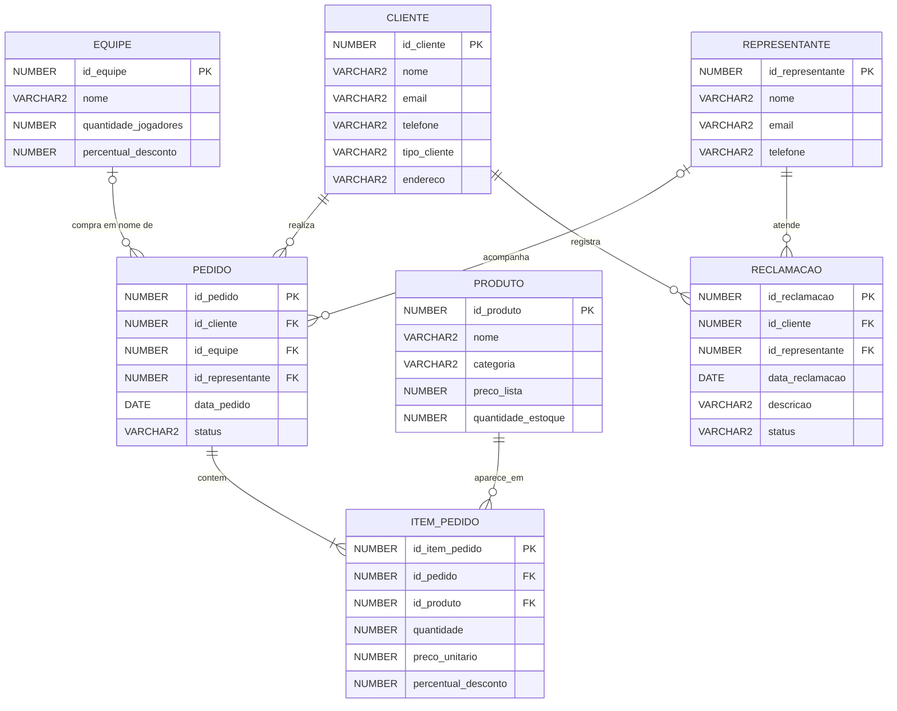

# Diagrama Entidade-Relacionamento

O diagrama abaixo usa Mermaid. No GitHub, ele pode ser exibido diretamente no Markdown.

## Cardinalidades principais

- **Cliente 1:N Pedido:** um cliente pode realizar vários pedidos; cada pedido pertence a um cliente.
- **Equipe 1:N Pedido (opcional no pedido):** uma equipe pode estar associada a vários pedidos; um pedido pode ser individual ou feito em nome de uma equipe.
- **Pedido 1:N Item_Pedido:** cada pedido contém um ou mais itens.
- **Produto 1:N Item_Pedido:** um produto pode aparecer em diversos itens de pedidos.
- **Cliente 1:N Reclamação:** um cliente pode registrar várias reclamações.
- **Representante 1:N Reclamação:** um representante pode atender várias reclamações.
- **Representante 1:N Pedido (opcional):** um pedido pode ser associado a um representante, especialmente em vendas para equipes.
